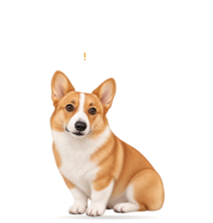
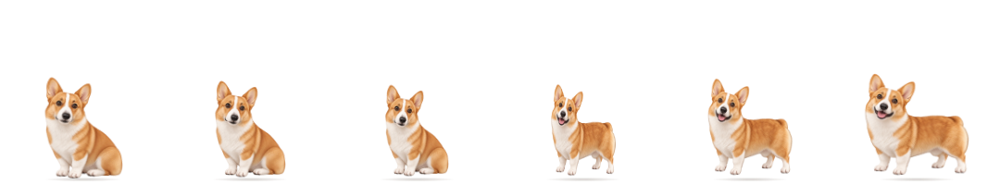
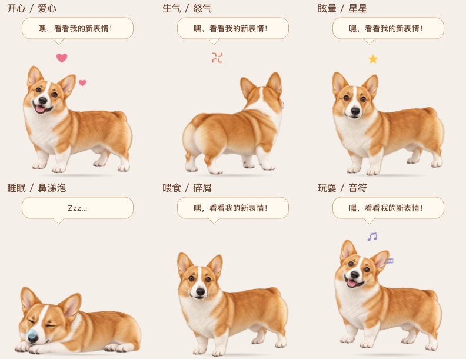

# DeskPaw 桌面柯基

以提供的柯基照片为原型制作的 macOS 桌面宠物。透明悬浮窗停在桌面底部，平时坐着待机，偶尔散步；支持单击、双击、拖拽、右键菜单、悬停、连续点击和闲置睡觉。



## 启动

需要 Python 3.11+ 和 macOS。当前项目已附有虚拟环境时可直接运行：

```bash
.venv/bin/python -m deskpaw
```

全新环境：

```bash
python3 -m venv .venv
.venv/bin/pip install -r requirements.txt
.venv/bin/python -m deskpaw
```

右键宠物可打开“设置”或“退出”。如果窗口被其他应用遮住，切回 DeskPaw 即可找到它。

## 交互

Windows 版的运行和打包方法见 [Windows 说明](docs/WINDOWS.md)。Windows x64 提供安装程序 `DeskPaw-Setup-x64.exe` 和免安装的 `DeskPaw.exe`；打包脚本与 GitHub Actions 会运行测试，并检查安装、启动和卸载。

| 操作 | 效果 |
| --- | --- |
| 单击 | 轮换抬爪、开心吐舌、小跳和抬头看你，并说一句话 |
| 双击 | 打开 AI 聊天窗口 |
| 拖拽 | 两帧悬空姿态让四肢晃动；松手后停留在放下的位置，拖到窗口上沿附近时自动停靠 |
| 右键 | 聊天、握手、丢球、接飞盘、追光点、找零食、五子棋、玩耍、睡觉、喂食、设置、退出 |
| 握手 | 右键选择握手，再单击伸出的爪子；也可回应它随机发起的握手邀请 |
| 丢球 | 球可往桌面任意方向投掷，柯基在整个桌面追球、接球或捡球，再回到开始的位置；方向和力度由最后一小段鼠标速度决定，停住再松手则直接落下 |
| 接飞盘 | 柯基在整个桌面追赶飞盘，接近头部时小跳接住，再叼回原位；没接住也会去捡，可拖飞盘再次投掷 |
| 追光点 | 光点跟随鼠标在桌面任意位置移动，柯基可上下、左右、斜向追赶；移动到新的位置才会再次计分，30 秒后结算 |
| 找零食 | 杯子会随机出现在桌面不同位置，其中随机藏一份零食；点杯子让柯基走过去检查，找错可以继续选，找到后吃零食并增加心情与亲密度 |
| 五子棋 | 打开独立棋盘与柯基本地对弈，你执黑先手；15×15 棋盘，横、竖或斜线连成五子即获胜（无禁手），支持悔棋和重新开始，无需 AI 配置或联网 |
| 悬停 | 转向鼠标并轻轻摆动身体 |
| 连续点三次 | 转身背对你一会儿 |
| 坐着待机 | 轻微呼吸，并随机眨眼、转头张望或挠耳；散步结束后坐回去 |
| 长时间不互动 | 张嘴打哈欠、趴下、入睡；触碰后醒来 |
| 空闲随机互动 | 偶尔说句话或邀你握手、玩球；对它单击会接下一句，可在设置里关闭 |

## 快速控制与位置记忆

小游戏使用当前显示器的整个可用桌面，宠物和玩具保持在可见区域。游戏结束后宠物保留当前位置，球和飞盘会先带回开始的位置。

macOS 菜单栏会显示爪印图标，点开可进入“宠物管理”，集中查看心情、亲密度、互动、五个小游戏和桌面控制。管理面板、右键菜单与菜单栏使用同一套线条图标，菜单按互动、小游戏、桌面控制分组。没有系统托盘的环境会自动显示管理面板，隐藏宠物后仍可通过它找回来。

暂停活动会停止散步、主动搭话、自动睡觉和小游戏，保留轻微呼吸和手动互动。锁定位置会禁止拖拽、散步和需要移动的游戏；在程序窗口上停靠时，锁定的是相对窗口的位置，柯基仍会跟随窗口。

上次停留的显示器、位置、暂停与锁定状态会自动保存，下次启动恢复。macOS 文件位于 `~/.config/DeskPaw/desktop.json`，Windows 位于 `%APPDATA%\DeskPaw\desktop.json`。显示器拔掉或分辨率改变时会调整到可见区域。

可把宠物拖到屏幕中间等任意可见位置，松手后会留在那里。想完全固定位置，可再打开“锁定位置”；选择“回到桌面”可移回屏幕底部。

## 趴在程序窗口上

macOS 和 Windows 上可抓住柯基任意部位，把鼠标拖到其他程序窗口上沿或标题栏附近（距上沿 40 像素以内）松手，它就会自动吸附，只露出头和两只搭在上沿的前爪，像扒着院墙看你；狗脚贴近上沿松手也能吸附。也可在爪印菜单或宠物右键菜单的“趴到程序窗口上”中选择窗口。柯基每半秒跟随窗口的位置与大小；窗口关闭、最小化或离开当前桌面后，它会回到桌面底部。

停靠使用新生成的透明探头素材 `deskpaw/assets/corgi-peek.png`，保持睁眼，爪尖稍微搭过窗口上沿。窗口紧贴屏幕顶部时会略向内调整，保证头和两只爪子完整可见。选择“回到桌面”可解除停靠，启动小游戏也会先解除停靠。位置记忆会尝试恢复仍存在的原窗口。[素材生成提示词](docs/perch-image-prompt.md)。

窗口识别支持 macOS 的 [Core Graphics](https://developer.apple.com/documentation/coregraphics/cgwindowlistcopywindowinfo(_:_:)) 和 Windows 的 [Win32 / DWM](https://learn.microsoft.com/en-us/windows/win32/api/winuser/nf-winuser-getwindowrect)，只读取窗口边界，不采集窗口画面。Windows 会按显示器缩放比例换算坐标。其他平台仍可使用隐藏、暂停、锁定和位置记忆。

## 心情与亲密度

喂食、单击摸摸、玩球和握手会提高心情与亲密度（上限均为 100）。右键菜单顶部显示当前数值。心情越好，柯基主动搭话、邀玩和待机小动作越频繁，台词也会随心情变化。数据保存在 `~/.config/DeskPaw/bond.json`，重启后继续保留。

接飞盘、追到光点和找到零食也有心情与亲密度奖励。右键“结束小游戏”可随时收起玩具；切换游戏、睡觉、打开聊天或拖拽宠物时也会结束当前游戏。玩具与小游戏均在本地运行。

桌面散步和捡球分别使用 24 帧步态。散步时四条小腿以短步幅前后摆动，至少一只后爪始终支撑地面；追球和带球返回时切换为前后腿成对发力、抬腿更高的奔跑动作，身体随步伐腾起，头脸朝向行进方向，移动速度也更快。步频由实际移动距离决定，停下后不原地踏步。

动画使用原图和多张由原图生成的姿态图，加上窗口变换和状态切换。散步起停有短暂加减速；相近姿态在 90ms 内融合，坐姿、站姿等差别较大的切换会以脚底为锚点收身、短暂换姿态再回弹。身体倾斜、位移和缩放会随姿态缓动；连续触发动作时会从当下可见的画面继续过渡。拖拽和握手的循环帧也会在交接前短暂融合。它目前不是骨骼动画。随机冒泡使用本地台词，不会自动调用付费 AI 接口；双击聊天时才会发起模型请求。



## 身体与情绪动效

宠物脚下有随离地高度变淡、缩小的接触阴影。小跳落地会压扁回弹，捡球急停时身体略微拉伸。拖拽过程中同一个透明窗口临时向下延伸，让阴影留在原来的地面上；放下后恢复窗口大小，并以新位置作为停留基准。

开心和握手会冒爱心，生气时有怒气纹，玩耍时有音符，眩晕时星星绕头，睡眠时鼻涕泡随呼吸胀缩。脚下扬尘、喂食碎屑等由最多 80 个粒子的本地引擎绘制；所有符号使用矢量路径，不依赖 emoji 字体。

设置中的“显示表情符号和粒子特效”可立即关闭装饰特效，阴影和身体回弹继续保留。动画计时器为 16ms（目标约 60fps），实际帧率取决于桌面环境。



## AI 聊天

默认使用 DeepSeek 官方的 `https://api.deepseek.com/chat/completions` 和 `deepseek-flash`。双击打开聊天窗口，点“设置”填写 API Key；macOS 使用系统钥匙串，Windows 使用凭据管理器，不写入项目设置文件。也可设置环境变量 `DEEPSEEK_API_KEY`。

其他兼容 OpenAI Chat Completions 的服务可在设置中填写 URL、模型名和密钥，或使用 `DESKPAW_API_KEY` 环境变量。远程服务需要 HTTPS；本机服务可使用 HTTP，且无需 API Key。聊天会发送最近 12 条消息作为上下文，界面不会保存对话记录。

聊天时说“去睡觉”或“握个爪”，柯基会在回复出现时执行对应动作；回复标题同时显示表情，宠物头顶也会显示相应表情符号（需开启动效）。兼容服务即使只返回普通文字，这两种明确指令也能生效。

聊天窗口使用左右气泡区分双方消息，回复带表情标记；快捷指令可直接填入输入框。Enter 发送，Shift+Enter 换行。设置页分成“宠物偏好”“宠物设定”“AI 聊天”“MCP 工具”和“HTTP MCP”。宠物设定可填写姓名、对你的称呼、性格、背景和自定义提示词，保存后下一条 AI 请求就使用这些信息；重启后继续保留。动作与表情联动也继续生效。

### Excel 任务（Agent 预览版）

聊天窗口点击“选择 Excel 文件”，选中一个 `.xlsx` 文件后，可以说“查看有哪些工作表”“预览销售表”“各月份销售额是多少”或“生成按月份汇总的销售额文件”。DeskPaw 会作为 MCP 客户端启动随程序提供的本地 Excel 工具服务，让模型按需要检查工作表、预览数据、按一列分组进行计数、求和或平均。只问统计结果时直接在聊天中回答；生成汇总文件前会显示具体操作和输出路径，请确认后才会写入。汇总结果保存为原文件旁边的新 `.xlsx` 文件，原文件不变。

当前每次任务最多生成一份汇总文件，支持 25 MB 以内、最多 40 列和十万条数据行的 `.xlsx`。只读取用户选中的文件；工作表信息和工具返回的数据会发给当前配置的聊天模型。公式预览使用文件内已有的计算缓存，没有缓存的公式可能显示为空。暂不支持宏文件、任意公式编辑或 Excel 应用自动重算。

### 自行连接 MCP 工具

在“设置 → MCP 工具”中添加本地 stdio MCP 服务，填写服务名称、启动命令和 JSON 数组形式的参数。例如启动命令填 `python`，参数填 `["-m", "my_document_mcp"]`；也可以填服务器程序的绝对路径。DeskPaw 直接启动该程序，不经过 shell。服务须在当前电脑上已安装，并且能通过 stdio 提供 MCP `tools/list` 和 `tools/call`。可以编辑、停用或移除服务。

在独立的“设置 → HTTP MCP”页添加 Streamable HTTP 服务，填写服务名称、MCP 地址和可选的 Bearer Token。远程服务须使用 HTTPS；本机 `localhost` 或回环地址可使用 HTTP。Token 保存在系统凭据存储中，不写入设置文件。当前不提供 OAuth 登录流程；需要 OAuth 的服务暂时无法直接连接。

添加支持 PDF 或 Word 的 MCP 服务后，在聊天窗口点“选择文件”选中 `.pdf` 或 `.docx`，再告诉宠物要做的事；无需输入文件的任务（例如从一段文字生成 PDF）也可以直接提出。可用功能由已连接服务的工具决定。连接服务、调用模型、读取文件都在后台进行；**每次调用外部工具前**，DeskPaw 会显示服务名、工具名与完整参数，得到确认才执行。本地服务以当前用户权限运行，因此只应添加自己信任的程序；本地服务的 API 密钥应放在启动环境中，不要写进参数或设置文件。选中的文件路径和工具返回内容会发送给配置的聊天模型；调用远程工具时，参数也会发往对应的 MCP 服务。

宠物趴着、睡着或停靠在程序窗口上时也能打开聊天。普通对话保持当前姿态和位置；明确请求握爪、睡觉或玩游戏时才执行对应动作。

设置文件位置：`~/.config/DeskPaw/settings.json`。其中保存地址、模型、宠物行为偏好及 MCP 服务配置，不保存聊天 API Key 或 HTTP MCP Token。

设置会显示密钥是否已配置及其来源。已保存的密钥不回显；“显示”按钮仅切换本次新输入的内容。“删除钥匙串密钥”会立即移除此服务的保存密钥，不必再点保存；环境变量中的密钥需在其来源处删除。退出程序不会清除已保存的密钥。

## 开发检查

项目已按配置、核心状态、AI 服务、外部适配、系统平台、界面和宠物行为拆分。目录职责、依赖边界与代码规范见 [架构说明](docs/ARCHITECTURE.md)。未来知识库已预留检索协议与后台聊天接入点，默认关闭；接入示例及待实现范围见 [知识库扩展说明](docs/KNOWLEDGE.md)。

```bash
.venv/bin/python -m pip install -e '.[dev]'
.venv/bin/ruff check deskpaw tests scripts packaging
.venv/bin/ruff format --check deskpaw tests scripts packaging
QT_QPA_PLATFORM=offscreen .venv/bin/python -m unittest discover -s tests -v
```

素材：`deskpaw/assets/corgi.png` 是用户提供的参考图；其他姿态图通过内置 ImageGen 依据该图生成，包括闭眼趴卧、张嘴打哈欠、背对镜头、两帧四肢悬空、抬爪、开心吐舌、捡球时朝行进方向的头脸、两帧相反步态，以及正面坐姿、正坐眨眼、正坐张望和正坐挠耳，均为透明背景的完整柯基。正坐使用 `corgi-sit-front*.png`，旧侧坐文件保留；[生成提示词](docs/front-sit-image-prompts.md)。球是程序绘制的简单图形。
