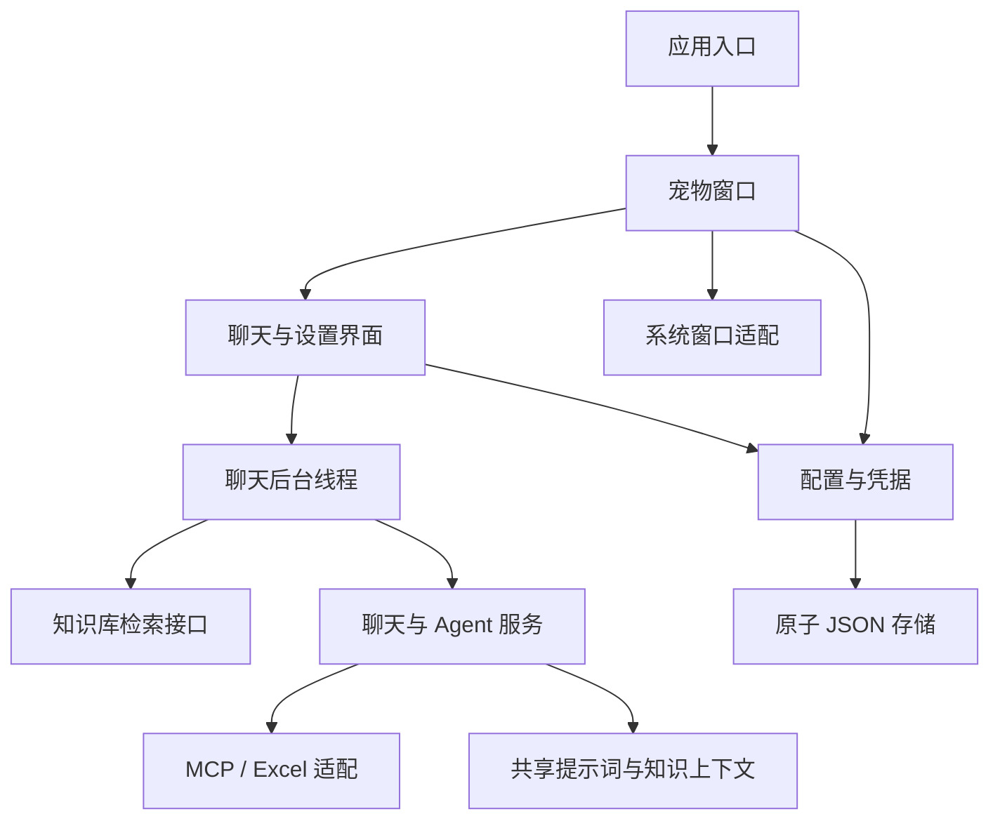

# 项目架构与代码规范

DeskPaw 按职责组织 Python 包。`python -m deskpaw` 仍是应用入口；启动时由 `__main__.main()` 组装配置、宠物窗口和桌面控制器。

## 目录职责

```text
deskpaw/
├── __main__.py        # 启动与依赖组装，先分流无界面的 MCP 命令
├── config/            # settings：非敏感偏好；credentials：系统凭据；paths：用户目录
├── core/              # 心情、桌面位置、JSON 持久化、素材路径
├── services/          # 模型请求、Agent 工具循环、共享提示词与上下文
├── knowledge/         # 知识库检索协议、结果模型和上下文预算
├── integrations/
│   ├── mcp/           # stdio 和 Streamable HTTP 客户端
│   └── excel/         # 有边界的工作簿操作与内置 MCP 服务
├── platform/          # macOS / Windows 窗口识别和 Windows 凭据适配
├── ui/                # 聊天、设置、MCP 编辑、桌面面板、后台线程、视觉组件
├── pet/               # 宠物生命周期、动画、位置、小游戏和玩具窗口
└── assets/            # 随安装包分发的素材
tests/                 # 离线单元测试、Qt 回归、架构边界测试
scripts/               # 开发和构建辅助命令
packaging/             # Windows 可执行程序与安装器
```

`services`、`integrations`、`knowledge` 和 `config` 不依赖 Qt；底层包不导入 `ui` 或 `pet`。`core.desktop` 使用 Qt 坐标类型，`platform` 使用系统窗口 API 和 Qt 显示器信息，因此它们并非完全与 GUI 框架无关。知识库协议只使用标准库。



## 宠物窗口的内部拆分

`pet.window.PetWindow` 是唯一的 QWidget 状态与生命周期拥有者，负责计时器、输入事件和行为协调。三个内部 mixin 分别容纳绘制与姿态过渡（`animation`）、停靠与位置控制（`placement`）、小游戏流程（`games`）。它们共享窗口状态，不独立实例化、不定义构造函数，也不创建另一个 Qt 主窗口。调整跨模块字段时须同步检查调用方及现有 UI 回归测试。

这次拆分保留原有动画和小游戏状态机；mixin 不是通用插件机制。新的独立能力优先通过有明确输入输出的服务或控制器组合接入，避免继续增加共享状态。台词和动效声明在 `constants`，姿态值对象在 `motion`。

## 聊天与扩展

`ui.chat` 管理界面，`ui.worker` 管理后台调用和工具确认信号。普通对话、Excel Agent 和通用 MCP Agent 使用 `services.prompts` 统一组装宠物设定、最近 12 条消息与可选知识上下文。工具写入和外部工具调用继续走原来的确认路径。

知识库通过 `KnowledgeService` 从应用入口注入，检索在聊天工作线程执行。具体契约、范围和后续接入步骤见 [知识库扩展说明](KNOWLEDGE.md)。

## 持久化和兼容性

- `Settings`、`Bond`、`DesktopState` 共用 `core.storage`：读取损坏文件时使用默认值，保存时先写同目录唯一临时文件，再原子替换。写入失败保留原文件并清理临时文件。
- 配置目录、JSON 字段、API Key 和 MCP Token 的系统凭据标识保持原样，已有用户数据无需迁移。密钥不进入 JSON 配置。
- 素材统一通过 `core.resources` 定位，支持源码运行、wheel 安装和 PyInstaller 的包内布局。
- 保留 `python -m deskpaw`、`python -m deskpaw --mcp-excel-server` 及旧的 `python -m deskpaw.excel_mcp` 命令。新 MCP 模块入口为 `python -m deskpaw.integrations.excel.server`。
- 平铺的内部模块路径已迁移。例如 `deskpaw.ai` → `deskpaw.services.ai`，`deskpaw.dialogs` → `deskpaw.ui.chat` / `settings` / `mcp_dialogs`，`deskpaw.pet.PetWindow` → `deskpaw.pet.window.PetWindow`。仓库内调用方与测试已更新；引用这些内部模块的外部脚本也需调整。`deskpaw.config` 保留公开配置 API。

## 开发约定

- Python 3.11+；四空格缩进、双引号、100 字符目标行宽，由 Ruff 格式化。长文本由格式器按语义保留。
- 函数、变量、模块使用 `snake_case`，类使用 `PascalCase`，常量使用 `UPPER_CASE`。Qt 事件覆盖方法保留框架名称，如 `paintEvent`。
- 跨包导入使用完整 `deskpaw.*` 路径；包内紧密关联模块可相对导入。禁止通配导入和底层模块反向依赖界面。
- 新增公共接口声明参数和返回类型。用 dataclass 表达稳定数据，用 Protocol 表达外部能力；避免将 Qt 控件或供应商 SDK 类型放入知识库契约。
- 文件与网络副作用放在明确的方法中，网络和检索操作不得阻塞 GUI 线程。可预期异常在边界转为可读错误；后台线程最外层负责向界面报告失败。
- 测试应验证行为、边界和失败场景。模型、凭据和远程服务使用替身；原生 Windows 凭据测试只在 Windows 运行。

安装和检查：

```bash
.venv/bin/python -m pip install -e '.[dev]'
.venv/bin/ruff check deskpaw tests scripts packaging
.venv/bin/ruff format --check deskpaw tests scripts packaging
QT_QPA_PLATFORM=offscreen .venv/bin/python -m unittest discover -s tests -v
```

修改后可运行 `ruff check --fix` 和 `ruff format`。`pyproject.toml` 定义包元数据、入口、素材和规范；运行时依赖继续以 `requirements.txt` 为单一来源。代码质量工作流运行格式、静态检查和离线测试；Windows 工作流负责原生打包与安装检查。
