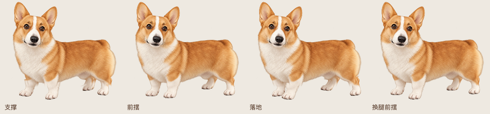
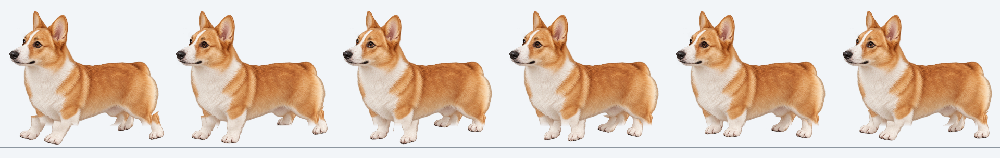

# 自然走路步态

之前的两张整图姿态把后爪抬得太高，轮换时像原地提腿。它们保留在素材目录供参考，当前走路不再调用。曾用内置 ImageGen 尝试重画低抬脚帧，但脚部位置或透明背景不稳定，因此最终采用可控的程序内步态。

当前 `deskpaw/gait.py` 从用户原始柯基图片中分离四条小腿，在宠物尺寸下缓存 24 个周期姿态。胸背、头脸保持同一张图；腿部以约 ±28 原图像素的步幅沿水平方向摆动，并围绕髋/肩轻微转动。支撑半周期中爪子保持在原地面线；前摆半周期最大离地约 14 原图像素。两条后腿交替支撑，前腿按对角节奏配合。

散步按实际横向移动距离推进 24 帧走路动画。捡球的追球及返回阶段使用独立的朝向素材 `corgi-run-facing.png` 生成 24 帧奔跑动画：头脸看向行进方向，后腿先蹬地，前腿随后伸出；奔跑腿部跨步约为走路的两倍，抬腿更高，身体腾起幅度也更大。100% 尺寸下移动速度为 280 像素/秒，其他尺寸下随宠物大小缩放；每个跑步循环对应 56 像素的实际位移，让更快的移动与步频保持同步。窗口不移动时不会出现原地踏步。旧照片素材 `corgi-walk-a.png`、`corgi-walk-b.png`、`corgi-walk-b-v2.png` 均未删除，但运行时不加载。

验证包括走路时后爪前后行程、至少一只后爪始终着地及抬脚高度上限；奔跑时更大的跨步及抬腿幅度、头脸像素稳定、追球与返回均使用奔跑帧，以及原有散步及捡球测试。

